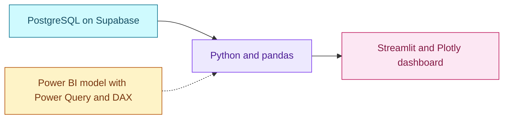

# Hi, I'm Agnaldo Peterson 👋

[🇧🇷 Português (Brasil)](README.md) · **🇺🇸 English**

**Data and BI Analyst · Automation and Software QA**

I build dashboards, automate data workflows, and migrate Power BI reports to Python web apps. I can help freelance clients with dashboard development and migration, data integration, and API test automation. I'm also interested in data and business intelligence roles.

   

## 🧰 Tech stack

      

## 🚀 Featured project — Power BI to Python

I migrated a lead and customer journey report to a web dashboard. The original Power BI model catalog contains **171 DAX measures** and **54 calculated columns**. The interactive demo uses fictional data to show how the sales funnel and date filters work. The linked demo and case study are in Brazilian Portuguese.

[Try the interactive demo](https://agnaldopeterson.github.io/#previa) · [Read the case study](https://agnaldopeterson.github.io/#migracao)

## 📊 Skills in practice

Each filled block represents one of the five featured projects where I used that skill.

| Skill | Projects | Where I used it |
| --- | --- | --- |
| SQL and databases |  | Migration, ETL, C# CRUD, sales dashboard |
| Power BI |  | Migration and sales dashboard |
| Python |  | Migration |
| C# |  | C# CRUD |
| JavaScript and Playwright |  | Verzel Store |
| Alteryx |  | ETL |

## 📂 Other projects

- **Verzel Store** — QA work with Gherkin scenarios, bug reports, and automated API tests in Playwright. [Code and evidence](https://github.com/agnaldopeterson/verzel-qa-test)
- **ETL automation** — data extraction, transformation, and migration using Alteryx, SQL, and Oracle.
- **C# CRUD app** — MVC application using PostgreSQL, Docker, and Postman. [Repository](https://github.com/agnaldopeterson/agnaldopeterson-20240530)
- **Sales dashboard** — Power BI and SQL Server demo. [View the demo](https://github.com/user-attachments/assets/92abd33e-803e-49b5-a556-294c2e85d6e4)

## 🎓 Education and languages

Bachelor's degree in Computer Science from UNIP and technical qualification in IT from ETEC Centro Paula Souza. Brazilian Portuguese and technical English.
