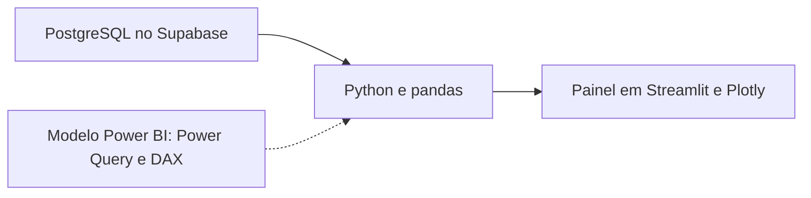

# Agnaldo Peterson

**Dados · Business Intelligence · Automação · QA**

Trabalho com análise de dados, Business Intelligence, automação e qualidade de software. Uso SQL, Power BI e Python para transformar regras de negócio em análises e aplicações.

[Portfólio](https://agnaldopeterson.github.io/) · [LinkedIn](https://www.linkedin.com/in/agnaldopeterson/) · [WhatsApp](https://wa.me/5516992566111) · [E-mail](mailto:agnaldopeterson@gmail.com)

## Habilidades em prática

Cada bloco preenchido representa um dos cinco projetos abaixo em que a habilidade aparece.

| Habilidade | Projetos | Onde usei |
| --- | --- | --- |
| SQL e bancos de dados | `■■■■□` 4/5 | Migração, ETL, CRUD em C#, Dashboard de vendas |
| Power BI | `■■□□□` 2/5 | Migração, Dashboard de vendas |
| Python | `■□□□□` 1/5 | Migração |
| C# | `■□□□□` 1/5 | CRUD em C# |
| JavaScript e Playwright | `■□□□□` 1/5 | Verzel Store |
| Alteryx | `■□□□□` 1/5 | ETL |

## Projetos

- **Migração de Power BI para Python** — caso Jornada dos Leads e Clientes. Migração de análises comerciais para um painel web com PostgreSQL no Supabase, pandas, Streamlit e Plotly. O catálogo do modelo original documenta 171 medidas DAX e 54 colunas calculadas. [Estudo de caso](https://agnaldopeterson.github.io/#migracao) · [Prévia interativa](https://agnaldopeterson.github.io/#previa)
- **Verzel Store** — teste técnico de QA com cenários em Gherkin, relatório de defeitos e automação de API com Playwright. [Código e evidências](https://github.com/agnaldopeterson/verzel-qa-test)
- **Automação de ETL** — fluxos de extração, transformação e migração de dados com Alteryx, SQL e Oracle.
- **CRUD em C#** — projeto MVC com PostgreSQL, Docker e Postman. [Repositório](https://github.com/agnaldopeterson/agnaldopeterson-20240530)
- **Dashboard de vendas** — demonstração em Power BI e SQL Server. [Visualizar imagem](https://github.com/user-attachments/assets/92abd33e-803e-49b5-a556-294c2e85d6e4)

## Fluxo da migração

## Formação

Bacharelado em Ciência da Computação pela UNIP e formação técnica em Informática pela ETEC Centro Paula Souza.
