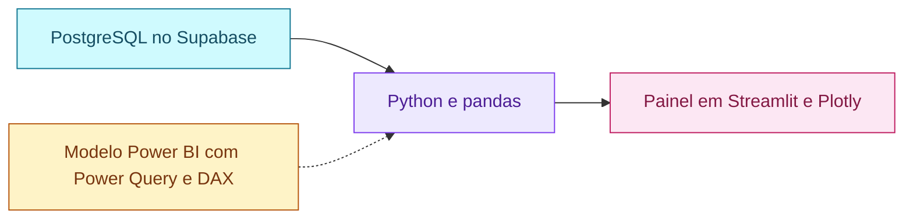

# Olá, eu sou Agnaldo Peterson 👋

**🇧🇷 Português (Brasil)** · [🇺🇸 English version](README.en.md)

**Analista de dados e BI · Automação e qualidade de software**

Crio dashboards, automatizo fluxos de dados e transformo relatórios Power BI em aplicações web com Python. Para projetos freelance, posso ajudar com criação e migração de dashboards, integração de dados e automação de testes de API. Também tenho interesse em vagas de dados e BI.

   

## 🧰 Tecnologias

      

## 🚀 Em destaque — Power BI para Python

Migração do relatório **Jornada dos Leads e Clientes** para um painel web. O catálogo do modelo original documenta **171 medidas DAX** e **54 colunas calculadas**. A prévia usa dados fictícios para demonstrar o funil e os filtros de período.

[Experimentar a prévia](https://agnaldopeterson.github.io/#previa) · [Ler o estudo de caso](https://agnaldopeterson.github.io/#migracao)

## 📊 Habilidades em prática

Cada bloco preenchido representa um dos cinco projetos apresentados em que usei a habilidade.

| Habilidade | Projetos | Onde usei |
| --- | --- | --- |
| SQL e bancos de dados |  | Migração, ETL, CRUD em C#, painel de vendas |
| Power BI |  | Migração e painel de vendas |
| Python |  | Migração |
| C# |  | CRUD em C# |
| JavaScript e Playwright |  | Verzel Store |
| Alteryx |  | ETL |

## 📂 Outros projetos

- **Verzel Store** — QA com Gherkin, registro de defeitos e testes de API em Playwright. [Código e evidências](https://github.com/agnaldopeterson/verzel-qa-test)
- **Automação de ETL** — extração, transformação e migração de dados com Alteryx, SQL e Oracle.
- **CRUD em C#** — aplicação MVC com PostgreSQL, Docker e Postman. [Repositório](https://github.com/agnaldopeterson/agnaldopeterson-20240530)
- **Dashboard de vendas** — demonstração com Power BI e SQL Server. [Ver demonstração](https://github.com/user-attachments/assets/92abd33e-803e-49b5-a556-294c2e85d6e4)

## 🎓 Formação e idiomas

Bacharelado em Ciência da Computação pela UNIP e formação técnica em Informática pela ETEC Centro Paula Souza. Português brasileiro e inglês técnico.
